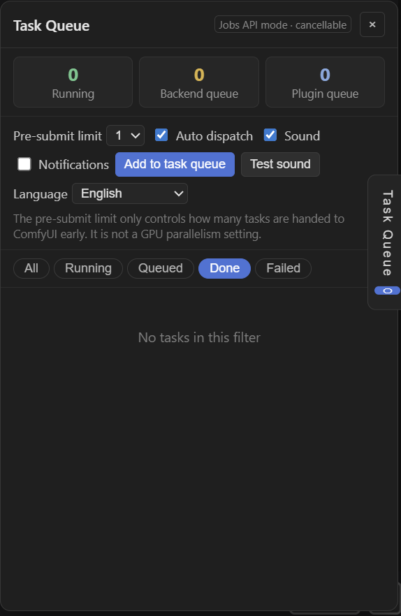

# ComfyUI-RH-TaskQueue

A RunningHub-style **task drawer** for ComfyUI: one panel that shows every task,
how long it really ran, what it produced, and a queue you can see and control.

**English** | [简体中文](README.zh-CN.md)

---

## What it is

ComfyUI tells you very little about the work you are doing. The queue is a
number in the corner, a finished job vanishes from the screen, and nothing
tells you how long a workflow actually took, or which workflow that was.

This plugin adds a panel on the right edge of the ComfyUI window that answers
those questions:

- **every task in one list** - running, waiting in the backend, waiting in the
  plugin queue, done or failed, with the name of the workflow that ran,
- **real execution time** - the time a job actually spent running, taken from
  ComfyUI's own `execution_start` event, kept apart from the time it spent
  waiting in a queue,
- **output previews** - images, video, audio, text and 3D files right in the
  card, with a link to the file and a button that opens the output folder,
- **a duration archive** - the last and the average runtime of a workflow, so
  the next run can be compared against reality,
- **a queue you control** - a green `❄ Run` button next to ComfyUI's own run
  button that submits into the plugin's queue, where the waiting tasks are
  visible, cancellable, and capped by a limit you choose,
- **an interface in your language** - English and Simplified Chinese, picked
  from the browser language or pinned in the drawer.

The plugin registers **no custom nodes** and adds **no dependencies**. It is a
frontend extension plus seven small HTTP routes on the ComfyUI server.

---

## Install

Clone the repository into your ComfyUI `custom_nodes` folder:

`@bash
cd <ComfyUI>/custom_nodes
git clone https://github.com/caramos2/ComfyUI-RH-TaskQueue.git
`@

Then restart ComfyUI. A page reload is enough for frontend-only changes, but
the Python backend is only picked up on a restart.

### Manual install

Copy or extract the whole repository into
`<ComfyUI>/custom_nodes/ComfyUI-RH-TaskQueue`. The folder name must stay
`ComfyUI-RH-TaskQueue` - ComfyUI loads every directory under
`custom_nodes` as a plugin.

### Requirements

| | |
|---|---|
| ComfyUI | 0.45.0 or newer (tested on 0.45.0, new frontend) |
| Python | 3.12 or newer |
| Node.js | only to run the test suite, never at runtime |
| Dependencies | none |

The plugin works with both ComfyUI APIs: it uses the `/api/jobs` endpoints
when they are available and falls back to `/queue` plus `/history`
otherwise. The badge in the drawer header tells you which one is in use.

---

## Using it

Open the drawer with the vertical **Task Queue** tab on the right edge.

| Area | What it shows |
|---|---|
| Header | the data source in use (*Jobs API mode* / *Legacy mode*) and whether cancelling is supported |
| Three counters | **Running**, **Backend queue**, **Plugin queue** - three separate numbers, never mixed up |
| Controls | pre-submit limit, auto dispatch, sound, notifications, *Add to task queue*, *Test sound*, language |
| Filters | All / Running / Queued / Done / Failed |

### The green ❄ Run button

The button sits directly to the right of ComfyUI's own run button. Hover it for
about a second and a tooltip explains what it does.

Pressing it:

1. **freezes the canvas** into a snapshot - a deep copy of the API prompt and
   the workflow, taken at the instant you press the button,
2. **puts that snapshot into the plugin's queue**, where the task waits until a
   pre-submit slot is free,
3. **shows the waiting count** on the button badge, and the waiting task in the
   drawer, where it can be cancelled.

Because the snapshot is a copy, later edits to the canvas cannot change what a
queued task runs with - and because the queue lives in IndexedDB, a page
reload does not lose it.

ComfyUI's own *Queue Prompt* button hands the workflow straight to the server,
where it waits in the server's queue. The difference is not the parameters -
ComfyUI captures those when it accepts a prompt - but **control**: the plugin
queue lets you hold tasks back, see them and cancel them.

### Pre-submit limit

A stock ComfyUI instance has a single `prompt_worker`. Many tasks can sit in
the queue, but they run **one after another**.

The *pre-submit limit* (1 to 8, default 1) controls how many tasks the plugin
hands over to ComfyUI at a time. Everything above that stays in the plugin's
own *Plugin queue*. It is **not** a GPU parallelism setting - real parallelism
needs several ComfyUI instances.

### Durations

A card shows three different things, and never mixes them up:

- **Backend queue** - the task is with ComfyUI and has not started yet,
- **Running** - the task is executing right now,
- **Duration** - how long it took once it finished.

The running timer starts from the server's own `execution_start` event, so
it is not an estimate.

### Output previews

| Type | How it is shown |
|---|---|
| Image | thumbnail grid, click for the full size |
| Video / Audio | inline player |
| Text | the text itself, plus a link to the file |
| 3D | the file name with an open/download link |
| Unknown | the file name and a download link - **never dropped silently** |

Every media URL goes through ComfyUI's own `/view` endpoint. The plugin never
builds a disk path, and it never accepts one from the browser.

### The duration archive

Every **successful** run is stored in a local SQLite database
(`data/duration_history.sqlite3`, git-ignored) and keyed by a signature of
the workflow:

- the signature is `SHA256(canonical_json(normalized_api_prompt))` with
  `signature_version = 1`,
- normalisation recursively strips `seed` and `noise_seed`, so a new random
  seed does not create a new record - but a different model, step count,
  resolution or prompt does,
- only successful runs count; failures and cancellations do not,
- every `prompt_id` is counted once, so a page reload cannot inflate the
  statistics.

A card then shows *last run* and *average (n runs)*. These are **references**,
not a prediction of the remaining time: hardware load, caches, model state and
parameter changes all affect the real duration.

### Sound and notifications

When a task finishes you can get a chime and a desktop notification.

Several tasks often finish within the same second, so the chimes are **merged**
into one - playing them all at once would sum their amplitude and burst. Every
chime also runs through one shared limiter. The browser only allows audio
after a user gesture, so press *Test sound* (or switch the sound on) once.

---

## The plugin's own HTTP API

All routes live under `/rh_queue` and are only used by the plugin itself.

| Route | Method | Purpose |
|---|---|---|
| `/rh_queue/health` | GET | version, database state, capability probe (Jobs API / Legacy / cancel) |
| `/rh_queue/estimate` | POST | last duration, average duration, sample count for a signature |
| `/rh_queue/record` | POST | store one successful run (idempotent per prompt id) |
| `/rh_queue/history` | GET | paged duration records |
| `/rh_queue/history/{signature}` | DELETE | delete one duration record |
| `/rh_queue/workflow_titles` | GET | graph id to workflow title map |
| `/rh_queue/reveal` | POST | open the output folder in the file explorer |

**The backend stores no task state, runs no queue and keeps no outputs.**
Those always come from ComfyUI's own API.

---

## Known limits

- With the browser completely closed, the plugin queue is not dispatched and no
  system notification appears - that is a browser limitation. A real
  background daemon would be needed for that.
- With several tabs open, only one tab dispatches the queue (a localStorage
  lease plus a BroadcastChannel). The others stay in sync. If the tab holding
  the lease loses the connection to the backend, it hands the lease over.
- A task that was submitted by **another** client - the API, another browser,
  another machine - has no `execution_start` event for this tab. The running
  timer then starts from the moment the task was first seen running, so it can
  be slightly late. The plugin cannot know when such a task really started.
- ComfyUI's own history retention still applies. The plugin stores duration
  summaries only; it is not an output archive.
- On a backend without a per-job cancel API, the *Cancel* button reports that
  cancelling is not supported instead of pretending to succeed.

---

## Development

`@powershell
# Frontend unit tests - pure logic, no browser required
node --test tests/js

# Backend unit tests
python -m pytest tests -q

# End-to-end check - needs ComfyUI on 127.0.0.1:8188
node tests/verify/verify_duration.mjs
`@

Two self-test workflows ship with the plugin:

- `example_workflows/zerogpu-selftest.api.json` - a string literal saved to a
  text file, it never touches the GPU,
- `example_workflows/min-sdxl-512.api.json` - a 512x512 SDXL run in four steps.

### Project layout

`@text
ComfyUI-RH-TaskQueue/
├── __init__.py                  # WEB_DIRECTORY + backend route registration
├── backend/
│   ├── routes.py                # the seven /rh_queue/* routes
│   ├── duration_store.py        # SQLite (WAL + transactions + idempotency)
│   └── fingerprint.py           # signature format validation
├── web/
│   ├── rh_task_queue.js         # the only file that registers an extension
│   ├── core/                    # api_client, task_model, task_store,
│   │                            # queue_manager, event_bridge, fingerprint,
│   │                            # snapshot, notifier, settings, i18n
│   ├── locales/                 # zh-CN.js, en.js
│   ├── adapters/                # jobs_api, legacy_api
│   └── ui/                      # drawer, task_card, timing_text,
│                                # run_button, output_preview, styles
├── tests/                       # pytest + node:test + end-to-end script
├── example_workflows/
└── docs/
`@

Only `web/rh_task_queue.js` calls `app.registerExtension`. Everything else
is a plain ES module, so the frontend cannot mistake it for a second extension
entry point.

### Adding a language or a string

Language packs live in `web/locales/`. Both packs must carry exactly the
same keys - the test suite compares the two key lists, so a missing
translation fails the tests instead of blanking a label. See
[CONTRIBUTING.md](CONTRIBUTING.md).

---

## Troubleshooting

| Symptom | Cause and fix |
|---|---|
| No drawer appears | check the ComfyUI log for `[ComfyUI-RH-TaskQueue] registered /rh_queue/* routes`; without it the frontend still loads but the duration archive does not work |
| The drawer says *Duration store not ready* | `/rh_queue/health` is not reachable - check that the plugin folder is under `custom_nodes` and that ComfyUI was restarted |
| The header says *Legacy mode* | this ComfyUI has no `/api/jobs`, so the plugin fell back to `/queue` + `/history` |
| Tasks stay in *Plugin queue* | the pre-submit limit is used up, or auto dispatch is switched off |
| No chime | browsers block audio until the user interacts - press *Test sound* once |
| No desktop notification | notifications have to be enabled and granted; a denied permission is not asked again |
| The run button is missing | the button is inserted next to ComfyUI's own run button; if ComfyUI re-renders the toolbar, the plugin puts it back automatically |

---

## License

[MIT](LICENSE) - Copyright (c) 2026 caramos2.

In plain words: anyone may use, copy, modify, merge, publish, distribute,
sub-license and sell this software, as long as the copyright notice and the
license text are kept. The software is provided **as is**, without warranty of
any kind - the authors are not liable for any claim, damage or other
liability arising from the use of it.

See [NOTICE.md](NOTICE.md) for the third-party notices. **This project
contains no third-party code**: everything was written for it, including the
SHA-256 implementation in `web/core/fingerprint.js`, which follows the
public FIPS 180-4 specification.

## Acknowledgements

- [ComfyUI](https://github.com/comfyanonymous/ComfyUI) - the host application.
  This plugin is not affiliated with it.
- The workflow duration archive idea came from the RunningHub task panel, which
  this plugin imitates in spirit but not in code.
