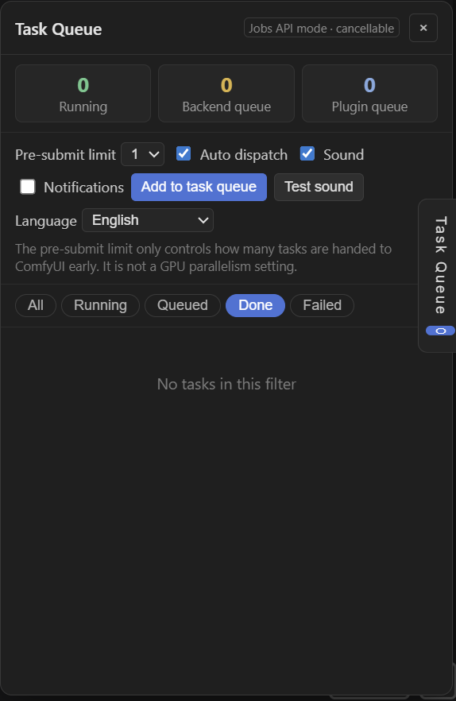

# ComfyUI-RH-TaskQueue

给 ComfyUI 加一个 RunningHub 风格的**任务抽屉**：一个面板看清所有任务、真实执行耗时、产出结果，并配一个你看得见、控得住的队列。

[English](README.md) | **简体中文**

---

## 这是什么

ComfyUI 对你正在做的事其实几乎不交代什么。队列只是角落里一个数字，跑完的任务就从屏幕上消失了，也没有任何地方告诉你一个工作流到底跑了多久、那又是哪个工作流。

这个插件在 ComfyUI 窗口右缘加一个面板，回答这些问题：

- **所有任务在一张列表里** —— 运行中、后端等待、插件排队、已完成、失败，都带着工作流的名字，
- **真实执行耗时** —— 任务真正跑了多久，取自 ComfyUI 自己的 `execution_start` 事件，并且和排队等待时间分开计算，
- **输出预览** —— 图片、视频、音频、文本、3D 文件直接在卡片里显示，并附文件链接和「打开文件夹」按钮，
- **耗时档案** —— 某个工作流上次跑了多久、平均多久，下次跑之前就能拿现实对照，
- **可控的队列** —— 绿色 `❄ 运行` 键就贴在 ComfyUI 原生运行键旁边，任务先进入插件自己的队列：等待中的任务看得见、可取消，数量上限由你定，
- **你的语言** —— 英文与简体中文，跟随浏览器语言，也可以在抽屉里手动锁定。

插件**不注册任何自定义节点**，也**不引入任何依赖**。它就是一个前端扩展，加上 ComfyUI 服务端上的七条小路由。

---

## 安装

把仓库克隆到 ComfyUI 的 `custom_nodes` 目录：

`@bash
cd <ComfyUI>/custom_nodes
git clone https://github.com/caramos2/ComfyUI-RH-TaskQueue.git
`@

然后重启 ComfyUI。只改前端的话刷新页面即可，但 Python 后端要重启才会加载。

### 手动安装

把整个仓库复制或解压到
`<ComfyUI>/custom_nodes/ComfyUI-RH-TaskQueue`。目录名必须保持
`ComfyUI-RH-TaskQueue` —— ComfyUI 会把 `custom_nodes` 下的每个目录当成插件加载。

### 环境要求

| | |
|---|---|
| ComfyUI | 0.45.0 及以上（实测于 0.45.0，新版前端） |
| Python | 3.12 及以上 |
| Node.js | 只用于跑测试，运行时完全不需要 |
| 第三方依赖 | 无 |

插件同时兼容两套 ComfyUI 接口：有 `/api/jobs` 时优先使用，没有时自动退回
`/queue` + `/history`。抽屉顶部的徽标会告诉你当前用的是哪一套。

---

## 使用

点击右缘竖排的**任务队列**标签打开抽屉。

| 区域 | 内容 |
|---|---|
| 顶栏 | 当前数据源（*Jobs API 模式* / *Legacy 模式*），以及是否支持取消 |
| 三个计数 | **运行中**、**后端排队**、**插件排队** —— 三个独立数字，绝不混算 |
| 控制区 | 预提交上限、自动派发、声音、通知、*加入任务队列*、*测试音效*、语言 |
| 筛选栏 | 全部 / 运行中 / 排队中 / 已完成 / 失败 |

### 绿色 ❄ 运行键

它就贴在 ComfyUI 原生运行键的右边。悬停约一秒会弹出说明。

按下它会发生三件事：

1. **把画布冻结成快照** —— 按下瞬间对 API prompt 与工作流做的深拷贝，
2. **把这份快照放进插件队列** —— 等到预提交名额空出来再交出去，
3. **把等待数量显示在键上的徽标**，任务同时出现在抽屉里，随时可以取消。

因为是拷贝，之后再怎么改画布都影响不到已排队任务；因为队列存在 IndexedDB 里，刷新页面也不会丢。

ComfyUI 原生的 *Queue Prompt* 是把工作流直接交给服务端排队的。差别不在参数 —— ComfyUI 接收 prompt 的那一刻就已经记下了当时的参数 —— 而在**掌控力**：插件队列让你能压住任务、看见任务、取消任务。

### 预提交上限

标准 ComfyUI 实例只有一个 `prompt_worker`。队列里可以堆很多任务，但它们是**一个接一个**跑的。

*预提交上限*（1 到 8，默认 1）控制的是插件一次交给 ComfyUI 多少个任务，超出的留在插件自己的*插件排队*里。它**不是** GPU 并行数，真正的并行需要多个 ComfyUI 实例。

### 耗时

卡片上分三件事，绝不混为一谈：

- **后端排队** —— 任务已在 ComfyUI 手里，还没开始，
- **运行中** —— 正在执行，
- **本次耗时** —— 跑完实际用了多久。

运行中的计时从服务端自己的 `execution_start` 事件起算，不是估算。

### 输出预览

| 类型 | 呈现方式 |
|---|---|
| 图片 | 缩略图网格，点击开原图 |
| 视频 / 音频 | 内嵌播放器 |
| 文本 | 正文直接显示 + 文件链接 |
| 3D | 文件名 + 打开/下载入口 |
| 未知类型 | 文件名与下载入口，**绝不静默丢弃** |

所有媒体地址都走 ComfyUI 自己的 `/view` 接口，插件不拼磁盘路径，也不接受来自浏览器的磁盘路径。

### 耗时档案

每次**成功**的运行都会写进本地 SQLite 库
（`data/duration_history.sqlite3`，已 gitignore），按工作流签名归档：

- 签名是 `SHA256(canonical_json(normalized_api_prompt))`，`signature_version = 1`，
- 归一化会**递归剔除** `seed` / `noise_seed`，所以换个随机种子不会产生新记录；
  改模型、改步数、改分辨率、改提示词则会，
- 只有成功的执行计入样本，失败与中止不计，
- 每个 `prompt_id` 只记一次，刷新页面不会把统计灌大。

卡片上会显示「上次耗时」与「平均（N 次）」。这是**历史参考**，不是剩余时间预测：
硬件负载、缓存、模型状态、参数变化都会影响真实时长。

### 音效与通知

任务结束可以响一声提示音，也可以弹系统通知。

多个任务常常在同一秒内结束，所以提示音会被**合并**成一声 —— 全部叠着响会把振幅叠加成爆音。所有提示音还共用一条限幅总线。浏览器要求先有用户手势才允许播放音频，所以先点一次*测试音效*（或把声音打开）。

---

## 插件自带的 HTTP 接口

所有路由都在 `/rh_queue` 下，只有插件自己会调用。

| 路由 | 方法 | 作用 |
|---|---|---|
| `/rh_queue/health` | GET | 版本、耗时库状态、能力探测（Jobs API / Legacy / 取消） |
| `/rh_queue/estimate` | POST | 按签名查上次耗时、平均耗时、样本数 |
| `/rh_queue/record` | POST | 写入一次成功执行耗时（按 prompt_id 幂等） |
| `/rh_queue/history` | GET | 分页查询耗时记录 |
| `/rh_queue/history/{signature}` | DELETE | 删除某条耗时记录 |
| `/rh_queue/workflow_titles` | GET | 图 id 到工作流标题的映射 |
| `/rh_queue/reveal` | POST | 在文件管理器里打开输出目录 |

**后端不存任务状态、不做队列、不存输出** —— 那些一律来自 ComfyUI 原生接口。

---

## 已知边界

- 浏览器完全关闭后不会派发插件队列，也不会弹系统通知 —— 这是浏览器限制。
  真正的后台常驻通知需要桌面伴随进程。
- 多标签页同时打开时只有一个标签页负责派发（localStorage 租约 + BroadcastChannel），
  其余标签页只读同步；持租约的标签页若与后端失联，会主动让出租约。
- **别的客户端**（API、另一台浏览器、另一台机器）提交的任务，在本标签页收不到
  `execution_start` 事件；运行中的计时只能从「第一次看到它在运行」开始算，可能略晚。
  这类任务真实何时开始，插件无从得知。
- ComfyUI 自身的历史保留策略仍然生效；插件只存耗时摘要，不是输出归档。
- 后端不支持按作业取消时，*取消* 按钮会如实报告无法取消，不假装成功。

---

## 开发与自检

`@powershell
# 前端纯逻辑单测（不需要浏览器）
node --test tests/js

# 后端单测
python -m pytest tests -q

# 端到端（需要 ComfyUI 在 127.0.0.1:8188 上跑着）
node tests/verify/verify_duration.mjs
`@

仓库自带两个自检工作流：

- `example_workflows/zerogpu-selftest.api.json` —— 字符串字面量存成文本文件，全程不碰显卡，
- `example_workflows/min-sdxl-512.api.json` —— 512×512 的 SDXL，4 步。

### 目录结构

`@text
ComfyUI-RH-TaskQueue/
├── __init__.py                  # WEB_DIRECTORY + 后端路由注册
├── backend/
│   ├── routes.py                # 七条 /rh_queue/* 路由
│   ├── duration_store.py        # SQLite（WAL + 事务 + 幂等表）
│   └── fingerprint.py           # 签名格式校验
├── web/
│   ├── rh_task_queue.js         # 唯一注册扩展的文件
│   ├── core/                    # api_client、task_model、task_store、
│   │                            # queue_manager、event_bridge、fingerprint、
│   │                            # snapshot、notifier、settings、i18n
│   ├── locales/                 # zh-CN.js、en.js
│   ├── adapters/                # jobs_api、legacy_api
│   └── ui/                      # drawer、task_card、timing_text、
│                                # run_button、output_preview、styles
├── tests/                       # pytest + node:test + 端到端脚本
├── example_workflows/
└── docs/
`@

只有 `web/rh_task_queue.js` 会调用 `app.registerExtension`，其余都是纯 ES 模块，
前端不会把它们误当成第二个扩展入口。

### 加语言或加文案

语言包在 `web/locales/`。两份语言包的键必须完全一致 —— 测试会比对两份键表，
少一个翻译就会让测试失败，而不是让界面上出现一个空白标签。详见
[CONTRIBUTING.md](CONTRIBUTING.md)。

---

## 故障排查

| 现象 | 原因与处理 |
|---|---|
| 抽屉没出现 | 看 ComfyUI 启动日志有没有 `[ComfyUI-RH-TaskQueue] registered /rh_queue/* routes`；没有说明后端注册失败，前端仍会加载但耗时库不可用 |
| 抽屉显示「耗时库未就绪」 | `/rh_queue/health` 没通 —— 检查插件目录是否在 `custom_nodes` 下、是否需要重启 ComfyUI |
| 顶栏显示「Legacy 模式」 | 该 ComfyUI 没有 `/api/jobs`，插件自动退回 `/queue` + `/history` |
| 任务一直停在「插件排队」 | 预提交上限被占满，或队列处于暂停；检查「自动派发」勾选状态 |
| 没有提示音 | 浏览器要求先有用户手势 —— 先点一次「测试音效」 |
| 没有桌面通知 | 需要手动勾选「通知」并授权；被拒绝后不会重复弹窗 |
| 运行键不见了 | 键是插在 ComfyUI 原生运行键旁边的；ComfyUI 重绘工具栏时插件会自动补回 |

---

## 许可证

[MIT](LICENSE) —— Copyright (c) 2026 caramos2。

用大白话说：任何人可以使用、复制、修改、合并、发布、分发、再许可乃至销售本软件，
前提是保留版权声明与许可证全文。软件按**现状**提供，不附带任何担保 ——
作者不对使用它产生的任何索赔、损害或其他责任负责。

第三方说明见 [NOTICE.md](NOTICE.md)。**本项目不含任何第三方代码**：
全部代码都是为本项目写的，包括 `web/core/fingerprint.js` 里的 SHA-256 实现，
它是按公开的 FIPS 180-4 规范独立实现的。

## 致谢

- [ComfyUI](https://github.com/comfyanonymous/ComfyUI) —— 宿主程序。本插件与其无隶属关系。
- 工作流耗时档案的思路来自 RunningHub 的任务面板，本插件只是精神上借鉴，代码是自己写的。
